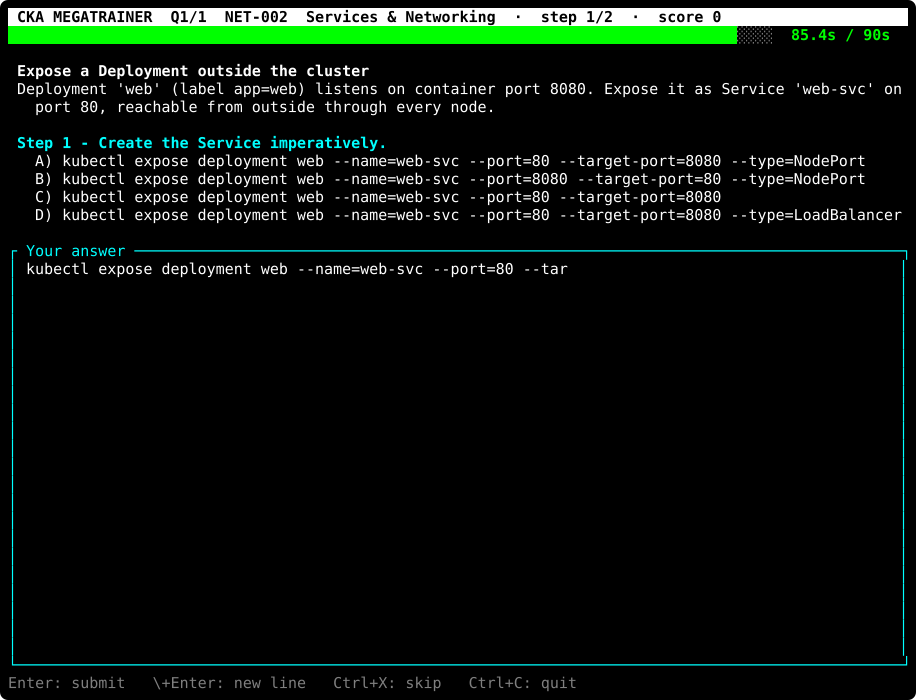
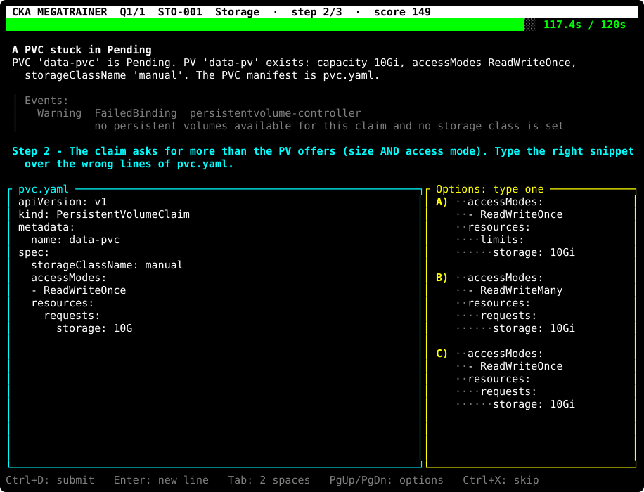
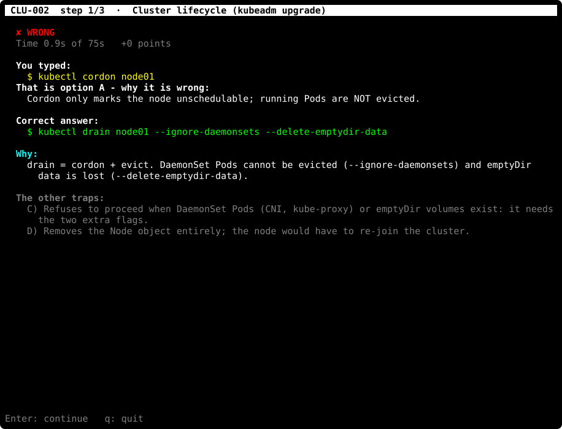

# CKA Megatrainer

A retro arcade game in your terminal to prepare the **Certified Kubernetes Administrator** exam
(Kubernetes v1.37). Choosing the right command is not enough: you have to **type it**, fast,
before the countdown runs out, just like in the real exam. Free software under the
[GNU GPL v3.0](LICENSE).

<p align="center"></p>

## What makes it different

Most CKA quizzes let you click an answer. The CKA exam gives you no options: you get a terminal,
a clock and about 7 minutes per task. CKA Megatrainer sits in between. You still see options,
but you can only answer the way the exam makes you work: **with your keyboard, under time pressure**.

- ⌨️ **You type, you don't click.** Picking an option means typing the whole command. Your fingers
  learn `--dry-run=client -o yaml` and `--ignore-daemonsets`, not just your eyes. A typo fails,
  like in a real shell.
- 🚫 **No copy/paste.** Pasted text is detected and thrown away. Speed has to come from you.
- ⏱️ **A countdown on every step**, green → yellow → red, with a speed bonus. Hesitation costs
  points, just as it costs tasks in the exam.
- 🧩 **Real tasks, step by step.** Questions are small scenarios that branch: diagnose → fix → verify,
  or generate YAML → edit it → apply it. One wrong step ends the scenario, like a broken cluster.
- 📝 **YAML you write yourself.** On edit steps you must type the right snippet *in the right
  place* of the file, with the right indentation (shown as `··` dots). Any equivalent fix is
  accepted: the whole file is checked, not your keystrokes.
- 🪤 **Traps that teach.** Every wrong option is a classic mistake (`cordon` instead of `drain`,
  `128M` instead of `128Mi`, a `- ports` that opens a second NetworkPolicy rule…) and every one
  is explained. YAML traps are even proven wrong automatically against the answer checks.
- 🎯 **Scored like the exam.** Partial credit per step and a **66 %** pass mark decide between
  **YOU WIN** and **GAME OVER**. Your results come up as `kubectl get pods`.
- 🕹️ **And it's an 80s arcade game.** A pixel-art Kubernetes helm, a chiptune soundtrack, a LEVEL
  screen per question and fireworks when you pass. Revision you actually want to come back to.

## Quick start

```bash
git clone https://github.com/Les-filles-et-les-garcons-de-la-tech/cka-megatrainer.git
cd cka-megatrainer
make start-exam        # install missing retro components automatically, then play!
```

Only Python 3.9+ and its standard library are needed (tested with Python 3.9 to 3.15). The
terminal must be at least 70x20 (100x38 is the intended size). This works on Linux and macOS;
on macOS, install Apple's command-line tools with `xcode-select --install` if Python or `make`
is missing.

`make start-exam` checks setup automatically on every launch, reusing installed fonts and
supported terminals. No separate installation command is needed:

- **macOS**: installs **Kitty** through [Homebrew](https://brew.sh/) if neither Kitty nor
  Alacritty is found. Without Homebrew, it prints instructions and plays in your current terminal.
- **Linux**: installs missing `curl`, `fontconfig` and a terminal (`foot` on Wayland, otherwise
  `xterm`) using apt, dnf, pacman, zypper or apk. System package installation may ask for your
  sudo password. Fedora Silverblue uses the existing `cka-dev` toolbox setup instead.

If installation fails, fix the reported problem and rerun `make start-exam`.

For a **fast start without setup**, or to play again using your current terminal's configured font:

```bash
make start-exam-here
```

### Reset installation for testing

Close the game window, then run:

```bash
make uninstall
make start-exam        # exercise installation again
```

Setup records the fonts, licenses, terminal and system packages it installs. `make uninstall`
removes those recorded components, the game sound cache, and local `dist/` and `__pycache__/`
outputs. On macOS it also removes setup-installed Kitty's cache and downloaded installer.
Pre-existing fonts and terminals are preserved. Linux package removal may ask for your sudo
password; a toolbox created by setup is removed, while a pre-existing toolbox is kept and only
setup-installed packages are removed from it. The repository and source changes are preserved.
Ownership tracking applies to installations made with this version of setup.

### Single-file version

The whole game (code, 100 questions, sounds) also fits in **one file**, `cka-megatrainer.pyz`
(about 140 KB), a standard Python zip application:

```bash
make dist                      # builds dist/cka-megatrainer.pyz
./dist/cka-megatrainer.pyz     # or: python3 dist/cka-megatrainer.pyz
```

Copy that file anywhere, to any Linux or macOS machine with Python 3.9+ (macOS ships Python 3.9
with its command-line tools), and run it: nothing else is needed. All options work the same
(`--exam`, `--silent`, `--theme soft`...). It plays in the current terminal: the retro font window
of `make start-exam` needs the repository and handles its own setup.

## Screenshots

| A command step: choose, then **type** it | An edit step: type the right snippet at the right place |
|:---:|:---:|
|  |  |
| **Every mistake is explained** | **YOU WIN**: your results as pods, under fireworks |
|  |  |

The images are animated SVGs made from real game sessions (`make readme-media` regenerates them).
They have no sound. The game itself plays an original chiptune.

## How it plays

1. Each question is a scenario split into **steps**, e.g. generate YAML → fix the file → apply it.
   **100 questions** cover the whole CKA curriculum, in the exam's proportions (see below).
2. **Command step**: options A–D. Type the full command of the one you choose. Typing another
   option's text means choosing it; typos count as wrong, just like in a shell. `k ` is read as `kubectl `.
3. **Edit step**: a file opens in an editor (e.g. the output of `--dry-run=client -o yaml`) next to
   snippet options. Type the right snippet **at the right place**, replacing the wrong lines. Leading
   spaces are shown as `·` so you can count the indentation.
4. The countdown bar turns **yellow at 50 %** and **red at 25 %** of the time left (max 2 min per step).
5. Every answer is explained: why your choice is wrong, the correct answer, the trap behind each
   other option. A wrong step ends the question with a recap of the full solution and an exam tip.
6. Scoring: 100 points per correct step + up to 50 speed bonus. **Copy/paste is blocked**: you type.

### Like the real exam: 15 to 20 tasks

**CKA EXAM**, the first menu entry, draws a new exam every time: a random number of questions
between **15 and 20**, like the real CKA, split across the domains by their exam weights. The menu
shows each domain's share of a 20-question exam:

| Domain | Weight | In a 20-question exam | In the library |
|---|---|---|---|
| Troubleshooting | 30 % | 6 | 30 questions |
| Cluster Architecture, Installation & Configuration | 25 % | 5 | 25 questions |
| Services & Networking | 20 % | 4 | 20 questions |
| Workloads & Scheduling | 15 % | 3 | 15 questions |
| Storage | 10 % | 2 | 10 questions |

The domain entries are for focused practice: they play all the questions of that domain.
**ALL QUESTIONS** plays the whole library.

At the end, your exam score is the share of correct steps (partial credit, like the real exam).
At **66 % or more**, the CKA pass mark, you get **YOU WIN** with fireworks; below, **GAME OVER**. Either way
your results come up as pods: READY = solved, RESTARTS = failed, AGE = time spent.

```
$ kubectl get pods -n cka-exam
NAME                    READY   STATUS            RESTARTS  AGE
cluster-8hjzw           2/2     Running           0         3m12s
troubleshooting-x4k2p   1/3     CrashLoopBackOff  2         6m40s
```

## Controls

| Key | Command step | Edit step |
|-----|--------------|-----------|
| Enter | submit | new line (keeps indentation) |
| `\` then Enter | continue on a new line | — |
| Ctrl+D | submit | submit |
| Tab | 2 spaces | 2 spaces |
| Ctrl+U | delete to start of line | delete to start of line |
| PgUp / PgDn | — | scroll the snippet options |
| Ctrl+X | skip step | skip step |
| Ctrl+C | quit | quit |

On the title screen: ↑/↓ and Enter, **M** toggles the music, **Q** quits.

## Commands

```bash
make start-exam                          # retro window with an 80s font
make start-exam ARGS="--domain storage"  # any option below, passed through ARGS
make start-exam-silent                   # no music / sound effects
make start-exam-here                     # in the current terminal
make uninstall                           # reset setup-installed components, caches and builds
RETRO_FONT="Press Start 2P" make start-exam   # NES arcade font instead of VT323
make test                                # validate questions.json + unit tests
make help                                # all targets

./cka_trainer.py --exam                      # a CKA exam right away (15-20 questions)
./cka_trainer.py --exam --count 20           # an exam of exactly 20 questions
./cka_trainer.py --domain troubleshooting    # practise one domain (all its questions)
./cka_trainer.py --id NET-001 --id TRB-003   # specific questions
./cka_trainer.py --count 5                   # 5 random questions
./cka_trainer.py --theme soft                # your terminal's colours instead of retro RGB
./cka_trainer.py --silent                    # no sound
./cka_trainer.py --allow-paste               # practise without the paste blocker
./cka_trainer.py --list                      # list question ids
./cka_trainer.py --validate                  # check questions.json
```

## The 80s experience

- **Title screen**: rotating pixel-art Kubernetes helm, rainbow pixel-font logo, starfield, flashing menu.
- **Sound**: an original NES-style chiptune (square-wave lead, triangle bass, noise drums), a jingle
  at each `LEVEL n` screen, win / lose sounds for every step, fanfares at the end of each question,
  firework booms. Everything is synthesised by the app (cached in `~/.cache/cka-megatrainer/`)
  and played with `pw-play`, `paplay`, `aplay` or `afplay`, whichever exists. Without a player
  the game is silent.
- **Colours**: the default `retro` theme uses exact RGB neon colours on pure black, like an arcade
  monitor, whatever your terminal's colour scheme. `--theme soft` uses your terminal's own colours.
- **Font window**: a terminal app cannot change the font of the terminal it runs in, so
  `make start-exam` opens a dedicated window (`foot`, `kitty`, `alacritty` or `xterm`) with
  **VT323** (a 1980s DEC terminal font, the default) or **Press Start 2P** (NES arcade), both under
  the SIL Open Font License. Automatic setup downloads them to
  `~/.local/share/fonts/cka-megatrainer/` (on macOS: `~/Library/Fonts`). Without a graphical
  session, the fonts or a supported terminal, the game simply starts in the current terminal.
- **YOU WIN**: bobbing rainbow letters, a victory theme, a demo-scene scroller and fireworks in
  five styles, including *helm* bursts with 7 rays like the Kubernetes wheel and embers raining down.

### On macOS

The game has been tested on a Mac by the maintainer. Reports from other macOS versions, Intel and
Apple Silicon Macs and other terminals are welcome:

- **Game and sound**: Python 3.9 comes with the command-line tools (`xcode-select --install`),
  and sounds play through `afplay`, built into macOS. The single-file `cka-megatrainer.pyz` is the
  easiest way in.
- **Retro font window**: `make start-exam` puts missing VT323 and Press Start 2P fonts in `~/Library/Fonts`.
  When Homebrew is available, it also installs Kitty if neither Kitty nor Alacritty is found.
  Terminal and iTerm2 cannot be given a font for one window, so `make start-exam` opens the game in
  **kitty** or **alacritty** if one is installed (`brew install --cask kitty`), from Homebrew or
  `/Applications`. Without them it plays in your current terminal.
- **Or simply**: pick *VT323* in your Terminal or iTerm2 profile and run `make start-exam-here`
  (or the `.pyz`).

## Tested on

The game is developed on Fedora Silverblue and has also been tested on **macOS** by the
maintainer (details per macOS version and terminal still to be documented). Linux setup:

| | |
|---|---|
| OS | **Fedora Silverblue 43** (immutable Fedora), GNOME on **Wayland** |
| Python | 3.14 (host); test suite and a full game also on 3.9, 3.10, 3.11, 3.12, 3.13 and 3.15 (toolbox) |
| Terminals | **Ptyxis** (Fedora's default, for `make start-exam-here`) and **foot 1.25** (the game window) |
| Game window | `foot` installed in a `cka-dev` **toolbox** by the automatic setup of `make start-exam`, leaving the host untouched |
| Sound | PipeWire with `pw-play` |
| Also checked | 80x24 and 100x38 sizes, both colour themes (screenshots taken in tmux 3.7); the single-file `.pyz` run alone from an empty directory; the macOS branches of the setup scripts in a simulated Mac environment (not on a real Mac) |

Not tested yet (help wanted!): other Linux distributions (Debian, Ubuntu, Arch, openSUSE…),
X11 sessions, other terminals (GNOME Terminal, Konsole, kitty, alacritty, xterm, Windows Terminal),
more **macOS** setups (versions, chips, terminals) and Windows through
WSL. Python's `curses` is not available on native Windows.

## Contributing

**Please try it on your distribution, terminal or platform and tell us how it went!** Open an issue
with your OS, terminal, Python version and what you saw (a screenshot helps). Even "it just works on
Ubuntu 24.04 + GNOME Terminal" is useful.

**Pull requests (merge requests) are welcome**: new questions (the database is meant to grow from
these 100: keep one question per percent of exam weight), fixes for other platforms, gameplay ideas. See [CONTRIBUTING.md](CONTRIBUTING.md)
for the question format and the checks to run.

## License

CKA Megatrainer is free software, licensed under the **GNU General Public License v3.0**:
see [LICENSE](LICENSE). You may use, study, share and modify it. If you distribute a modified
version, it must stay under the same license, with its source code available.

The fonts are not part of this repository: automatic setup downloads them from Google Fonts
under their own SIL Open Font License.

---

Kubernetes is a registered trademark of The Linux Foundation. This project is a community study
tool, not affiliated with the CNCF or The Linux Foundation. Fonts by Peter Hull (VT323) and
CodeMan38 (Press Start 2P), SIL Open Font License.
